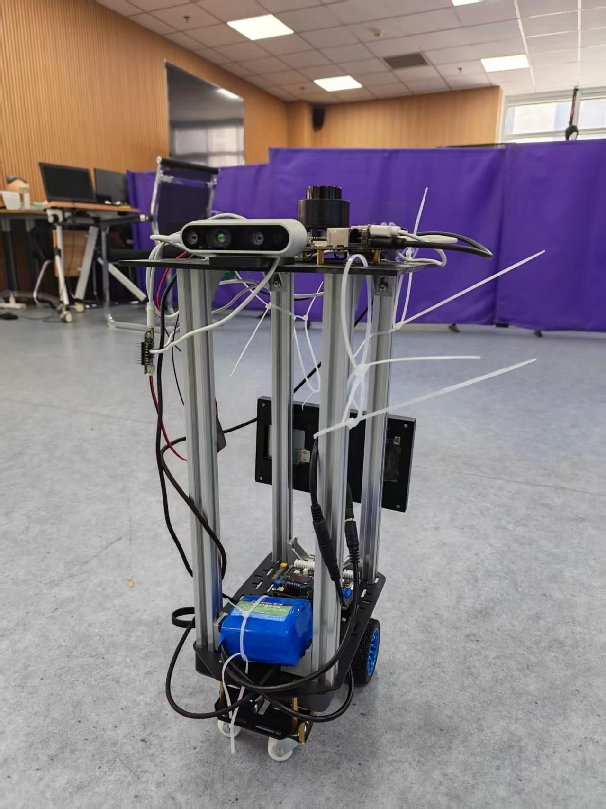
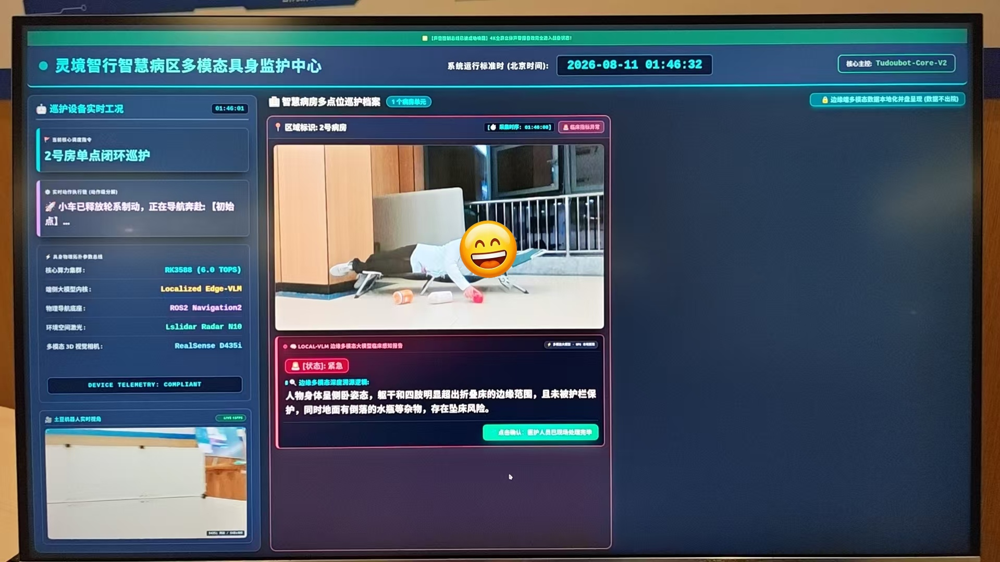
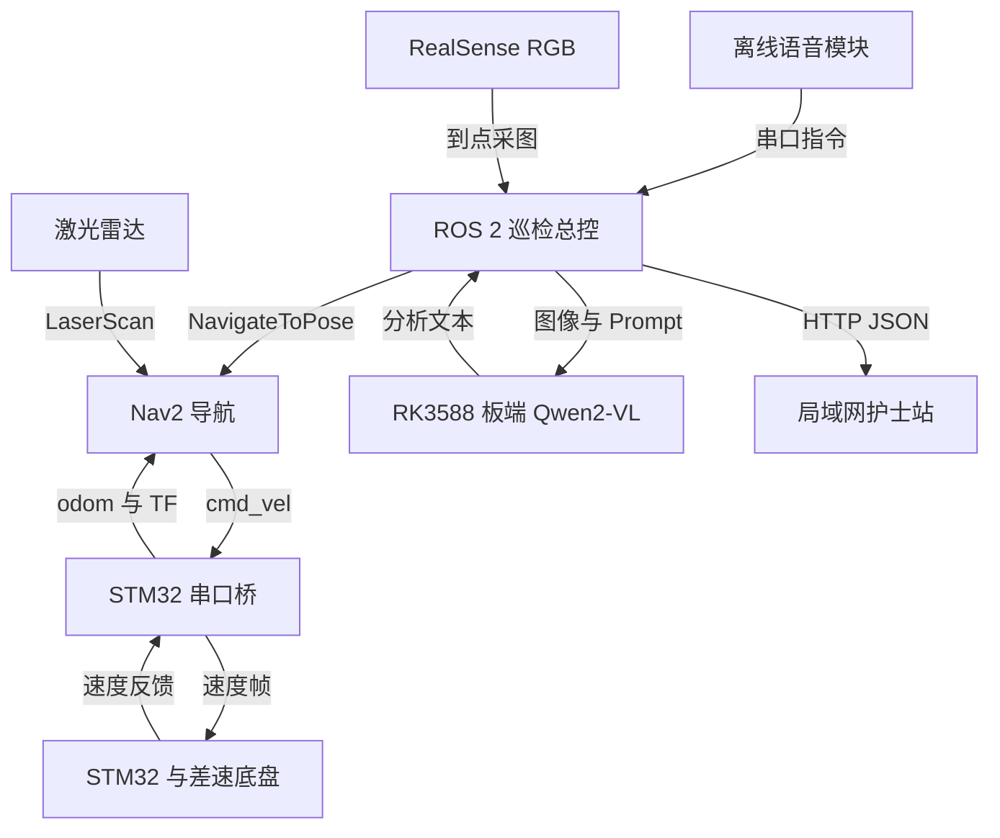

# 灵境·智行｜基于 RK3588 的多模态病房巡检机器人

**Tudou Robot · ROS 2 Navigation × Edge VLM × Autonomous Patrol**

面向康养病房场景的移动巡检机器人：通过离线语音触发任务，自动导航到指定病房，采集现场图像，在 RK3588 上运行 Qwen2-VL-2B 视觉语言推理，并将图像、分析文本和任务状态发送至局域网护士站。

项目将 **STM32 差速底盘、ROS 2 Humble、Nav2、RealSense RGB 图像采集与端侧多模态推理** 串联成巡检任务链，重点探索嵌入式机器人上的感知、移动、任务编排与远程交互。

<p align="center">
  
</p>

<p align="center"><b>离线语音触发 · 自主导航 · 到点拍照 · 端侧推理 · 局域网上报</b></p>

> 当前仓库公开机器人侧 ROS 2 代码。模型权重、板端推理可执行程序、STM32 固件与护士站 Web 服务需单独准备。多点巡检版本仍有待修复项，详见下方“当前状态与已知限制”。项目用于研究与场景演示，视觉语言模型输出是辅助观察结果，不能替代医疗判断。

## 目录

- [项目功能](#项目功能)
- [系统架构](#系统架构)
- [核心工程实现](#核心工程实现)
- [硬件与软件](#硬件与软件)
- [代码导航](#代码导航)
- [部署与运行](#部署与运行)
- [通信接口](#通信接口)
- [当前状态与已知限制](#当前状态与已知限制)
- [后续计划](#后续计划)

## 项目功能

| 功能 | 实现方式 |
| --- | --- |
| 离线语音触发 | 串口接收语音模块识别后的指令码，不在 ROS 节点内运行语音识别模型 |
| 自主建图与导航 | SLAM Toolbox 建图；AMCL 定位；Nav2 路径规划、局部避障和目标执行 |
| 单点巡检 | 到指定病房后采图，调用板端 VLM，上传图像与分析结果 |
| 多点任务编排 | 用任务数组和索引组织病房访问与返回初始点的流程 |
| 端侧多模态推理 | 调用 RK3588 上的 Qwen2-VL-2B 推理程序，输入 RGB 图像与文本提示词 |
| 远程状态展示 | 通过 HTTP JSON 上报巡检结果及全局任务、当前子任务 |
| 底盘通信 | 速度指令编码、串口反馈校验、里程计积分与 TF 发布 |

报告中的护士站展示效果如下；**Web 服务源码尚未包含在本仓库中**。



## 系统架构



职责分工：

- **STM32**：接收运动控制帧并反馈底盘数据，具体固件不在当前仓库中。
- **ROS 2 / Nav2**：负责定位、规划、运动目标执行及设备通信。
- **巡检总控节点**：负责语音指令解析、导航结果回调、拍照触发、推理和上报。
- **端侧 VLM**：解释现场图像，生成文本观察结果；不直接生成底盘控制指令。
- **护士站**：接收机器人任务状态和巡检结果，提供远程展示。

## 核心工程实现

### 1. 基于反馈的巡检任务链

多点版本通过 `patrol_sequence`、`current_step_index`、`is_patrolling` 维护任务进度。导航采用 `NavigateToPose` Action，收到成功结果后才触发拍照，推理及上报处理结束后推进下一目标。执行期间忽略新语音指令，避免重复下发任务。

| 指令码 | 多点版本任务序列 |
| --- | --- |
| `0x01` | 1 号病房 → 初始点 |
| `0x02` | 2 号病房 → 初始点 |
| `0x03` | 1 号病房 → 2 号病房 → 初始点 |

这是当前代码的正常路径设计。异常跳过函数尚未补齐，上报失败也没有形成可靠确认机制，不能据此推导“所有异常下都能完成闭环”。

### 2. 到点采图与推理线程

多点版本持续订阅 `/camera/camera/color/image_raw`，在导航成功时设置 `need_snapshot`。下一次收到图像回调后保存图像，并启动独立线程执行模型推理，减少长耗时推理对 ROS 回调处理的影响。

当前巡检 launch 关闭深度、红外及相机 IMU 流，仅启用 RGB 图像。安装了 D435i 不等于当前巡检算法使用了深度信息。

### 3. VLM 交互式进程输出解析

总控通过 `subprocess.Popen` 启动板端推理程序，向标准输入写入带换行符的 Prompt 并主动刷新。输出端使用 `select` 与 `read(1)` 读取文本，识别 `robot:` / `user:` 交互标识，提取模型回复。

该实现针对交互式模型输出不按行结束的情况，避免完全依赖 `readline()` 等待换行。当前仍需完善标准错误流排空、进程回收和整轮推理截止时间，`bufsize=0` 本身不构成无阻塞保证。

### 4. ROS 2 与 STM32 串口桥

[`stm32_bridge.py`](src/tudou_bringup/src/stm32_bridge.py) 实现：

- 订阅 `/cmd_vel`，编码为 11 字节控制帧。
- 解析 24 字节反馈帧，检查帧头 `0x7B`、帧尾 `0x7D` 与异或校验。
- 根据反馈速度进行平面里程计积分，发布 `/odom` 和 `odom → base_footprint`。
- 以 10 ms 定时器轮询串口，在串口异常后尝试重新打开。
- 捕获 `Ctrl+C` 时尝试发送零速度帧。

10 ms 是配置的轮询周期，不代表已验证的 100 Hz 反馈频率或硬实时控制。底盘角速度反馈包含符号修正，迁移到不同固件时必须核对坐标与转向约定。

## 硬件与软件

| 层级 | 配置或依赖 |
| --- | --- |
| 主控 | 飞凌 ELF2 / Rockchip RK3588；报告配置为 8 GB RAM、64 GB eMMC |
| 执行机构 | STM32 下位机、两轮差速底盘 |
| 激光雷达 | 当前代码使用 `lslidar_driver`，启动 `lsn10_launch.py`；实机型号需与驱动匹配 |
| 视觉 | Intel RealSense D435i，巡检使用 RGB 图像 |
| 交互 | 离线语音模块；报告展示本地屏与护士站界面 |
| 机器人中间件 | ROS 2 Humble、Nav2、SLAM Toolbox、TF2、URDF/Xacro |
| 导航配置 | AMCL、Navfn 全局规划器、DWB 局部控制器 |
| 端侧模型 | Qwen2-VL-2B；视觉模型 `.rknn`，语言模型 `.rkllm` |
| 应用依赖 | Python 3、OpenCV、cv_bridge、pyserial、requests |

报告与源码的雷达描述存在差异，本 README 以仓库中的启动配置为准。NPU runtime、模型转换工具及模型文件需要使用相互兼容的版本，当前仓库尚未给出完整版本锁定信息。

## 代码导航

| 路径 | 用途 |
| --- | --- |
| [`src/tudou_description`](src/tudou_description) | 机器人 URDF/Xacro、传感器坐标系和 RViz 配置 |
| [`src/tudou_bringup`](src/tudou_bringup) | STM32 串口桥、硬件启动和 SLAM 启动 |
| [`src/tudou_navigation2`](src/tudou_navigation2) | Nav2 参数、已有地图和导航启动 |
| [`src/tudou_voice_navigation`](src/tudou_voice_navigation) | 语音触发导航的独立版本 |
| [`src/tudou_patrol`](src/tudou_patrol) | 单点巡检总控，串联导航、图像、VLM 和上报 |
| [`src/tudou_patrol2`](src/tudou_patrol2) | 多点巡检与返回初始点的扩展版本 |
| [`src/lslidar_ros2`](src/lslidar_ros2) | 第三方激光雷达驱动与消息定义 |
| [`src/REALME.md`](src/REALME.md) | 早期调试命令记录，包含需要按环境调整的旧路径 |

语音导航、单点巡检和多点巡检是不同运行入口，**一次只启动一种任务总控**，避免串口争用与重复导航任务。

## 部署与运行

以下命令基于仓库启动文件整理，尚未在全新 RK3588 环境中完成端到端复现验证。先完成基础导航，再接入 VLM 巡检；多点流程还需先修复已知问题。

### 1. 获取工作空间

在已安装 ROS 2 Humble 的目标 Linux 环境中：

```bash
git clone https://github.com/jintiankaodiguachi/tudou-robot-ros2.git
cd tudou-robot-ros2
source /opt/ros/humble/setup.bash
```

仓库根目录可直接作为 colcon 工作空间，不需要再套一层 `src`。

### 2. 准备依赖与编译

需要提前安装与板卡系统兼容的 ROS 2、colcon、rosdep、Nav2、SLAM Toolbox、RealSense 驱动及相关 Python 依赖。已初始化 rosdep 的环境可执行：

```bash
rosdep install --from-paths src --ignore-src -r -y --rosdistro humble
colcon build --symlink-install
source install/setup.bash
```

当前部分 `package.xml` 依赖声明不完整，rosdep 执行成功不等于所有运行依赖齐全。重点检查 `rclpy`、`cv_bridge`、`serial`、`requests`、`realsense2_camera`、Nav2、SLAM Toolbox、Xacro 与 RViz。

### 3. 调整本机配置

| 配置项 | 当前入口 | 调整说明 |
| --- | --- | --- |
| 底盘串口 | `tudou_bringup/src/stm32_bridge.py` | 默认 `/dev/ttyACM0`、115200，当前写在源码中 |
| 语音串口 | 巡检节点 ROS 参数 `port`、`baudrate` | 默认 `/dev/ttyUSB0`、115200 |
| 雷达串口 | `lslidar_driver/config/lslidar_n10_uart.yaml`，位于嵌套驱动目录 | 默认 `/dev/ttyUSB1` |
| 地图 | `tudou_navigation2/maps/health_care_map.yaml` | 替换为现场地图，并检查对应图像路径 |
| 病房与返回点 | 多点节点 `room_goals`、`initial_pose` | 在现场地图中重新标定，`z/w` 为四元数分量 |
| 模型目录 | 巡检节点 `qwen_cwd` | 指向板端推理程序和模型所在目录 |
| 图像输出 | 巡检节点 `image_path` | 目录必须存在且可写 |
| 护士站地址 | `nurse_server_url`、`watchdog_server_url` | 替换为局域网服务地址 |

模型工作目录需要有 `demo`、`qwen2_vl_2b_vision_rk3588.rknn`、`Qwen2-VL-2B-Instruct.rkllm` 及所需运行库。这些文件**不随仓库提供**；应先独立验证模型可运行且交互标识与解析逻辑一致。

更换场地后不能直接沿用已有病房坐标。串口设备建议通过 `/dev/serial/by-id/` 或 udev 规则稳定绑定。

### 4. 验证基础导航

每个新终端均需加载 ROS 环境及当前工作空间。

终端 A：

```bash
ros2 launch tudou_bringup bringup.launch.py
```

终端 B：

```bash
ros2 launch tudou_navigation2 tudou_nav2.launch.py
```

在 RViz 中设置初始位姿，确认激光与地图对齐，再发送导航目标。`bringup.launch.py` 启动机器人模型、雷达与底盘桥，不启动 SLAM。

如需重新建图，使用 `tudou_slam.launch.py` **替代**上述硬件启动，不要同时重复启动同一组设备节点：

```bash
ros2 launch tudou_bringup tudou_slam.launch.py
```

另开终端进行键盘控制与地图保存：

```bash
ros2 run teleop_twist_keyboard teleop_twist_keyboard
# 下列保存命令在仓库根目录执行
ros2 run nav2_map_server map_saver_cli -f ./src/tudou_navigation2/maps/site_map
```

建图完成后停止建图流程，重新构建以安装新增地图；导航可通过 `map:=绝对路径` 指定地图。巡检联合启动默认使用 `health_care_map.yaml`，自定义地图时还需调整联合启动的参数传递或默认地图配置。

### 5. 启动巡检

先准备护士站服务和模型程序，保持终端 A 的硬件 bringup 运行；停止单独运行的 Nav2，再选择一种巡检入口：

```bash
# 单点巡检
ros2 launch tudou_patrol tudou_patrol.launch.py
```

```bash
# 多点巡检：先修复“当前状态与已知限制”中的阻断项
ros2 launch tudou_patrol2 tudou_patrol2.launch.py
```

巡检 launch 已包含 Nav2 和 RealSense 相机启动，避免重复启动。等待导航就绪并完成初始定位后，再用语音模块触发任务。

### 6. 常用检查

```bash
ros2 node list
ros2 topic list
ros2 action list
ros2 topic hz /scan
ros2 topic hz /odom
ros2 topic info /camera/camera/color/image_raw --verbose
ros2 run tf2_ros tf2_echo odom base_footprint
```

图像存在但节点收不到时，检查话题名及发布/订阅 QoS 是否匹配；不要只检查摄像头是否插入。

## 通信接口

### ROS 2

| 接口 | 类型 | 用途 |
| --- | --- | --- |
| `/cmd_vel` | `geometry_msgs/msg/Twist` | 下发底盘速度 |
| `/odom` | `nav_msgs/msg/Odometry` | 底盘速度积分与里程计 |
| `/scan` | `sensor_msgs/msg/LaserScan` | 激光扫描 |
| `/camera/camera/color/image_raw` | `sensor_msgs/msg/Image` | 到点采集 RGB 图像 |
| `/navigate_to_pose` | `nav2_msgs/action/NavigateToPose` | 导航目标与结果反馈 |

### 巡检报告：`POST /api/report`

以下是多点节点的报文示例，字段与当前代码一致；`image_data` 实际为图片内容的 Base64 字符串。

```json
{
  "robot_id": "L_POTATO_01",
  "location": "1号病房",
  "vlm_analysis": "[状态]: 正常 [原因]: 示例观察结果",
  "image_data": "<base64_image>",
  "status_level": "NORMAL"
}
```

当前通过回复是否包含 `[状态]: 紧急` 设置 `EMERGENCY`，其他情况默认 `NORMAL`。这属于演示级文本解析，格式错误或未知结果应在后续版本中单独表示，不能直接视为正常。

### 任务状态：`POST /api/status`

```json
{
  "global_task": "全流程大循环巡护",
  "sub_task": "正在导航至1号病房"
}
```

当前 HTTP 接口不是可靠消息队列；状态上报与报告上传的失败处理能力不同，后续需补充失败状态、确认和重试。

## 当前状态与已知限制

本说明依据公开代码快照 `13a3a36` 与项目作品报告整理。

| 项目 | 当前状态 |
| --- | --- |
| 机器人侧代码 | 已公开模型描述、底盘桥、建图导航和巡检总控 |
| 完整演示系统 | 报告展示实机与护士站效果；部分依赖和组件尚未公开 |
| 多点异常跳过 | 调用了 `emergency_skip_next()`，但当前类中未定义该方法 |
| 推理异常日志 | 使用了不存在的 `get_gradient_logger()`，需要改正 |
| 重复方法 | 多点节点重复定义推理和上报方法，Python 实际使用后面的定义 |
| 相机与推理超时 | 尚无完整的拍照等待截止机制；读取超时不等于整轮任务超时 |
| 上报可靠性 | 部分异常被忽略，上传失败后仍可能显示成功并推进任务 |
| 退出与进程管理 | 仍需完善推理进程、stderr 管道、线程退出和资源回收 |
| 复现配置 | 模型路径、房间坐标和服务地址存在硬编码，需逐项调整 |

报告包含推理吞吐、识别准确率、导航精度和长时间运行数据，但仓库尚未提供完整测试脚本、数据集口径与原始日志，因此暂不作为可复现性能承诺。当前 Nav2 到达容差为位置 `0.25 m`、角度 `0.25 rad`；**容差参数也不等同于实测定位或到达精度**。

## 后续计划

- [ ] 修复多点巡检异常分支、重复方法与日志调用。
- [ ] 将房间坐标、模型路径、服务地址和超时值迁移到 YAML / ROS 参数。
- [ ] 为拍照、推理、上报增加可区分的成功、失败和超时状态。
- [ ] 完善子进程生命周期、线程退出及结构化日志。
- [ ] 补充护士站 Web 服务、模型部署步骤和下位机协议文档。
- [ ] 提供完整任务视频、版本依赖表和实测性能记录。
- [ ] 增加模拟 Nav2 结果、模型输出和网络失败的离线验证。

## 来源与许可证

项目展示图片提取自《2026嵌入式大赛应用赛道作品报告》。仓库复用了 ROS 2、Nav2、SLAM Toolbox、RealSense、Qwen 及激光雷达厂商生态中的组件。

多个自有 ROS 功能包包含 Apache-2.0 许可证文件；第三方驱动、模型及部署工具的许可需分别遵守各自上游条款。模型权重不包含在本仓库中。
